

  

  
  
  
  

  

I like breaking things to understand them, then writing down how to stop it happening again. My work sits where **offensive security** meets **governance**: I find the vulnerability, then I model the risk, the control and the recovery plan around it.

  

  <a href="https://github.com/RoshFps/GRC_Portfolio">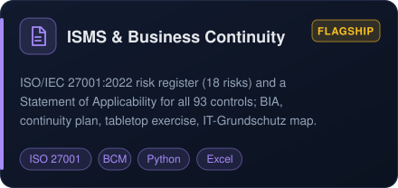</a>
  <a href="https://github.com/RoshFps/SkrillX">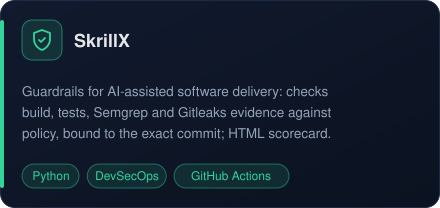</a>

  <a href="https://github.com/RoshFps/home-siem-lab">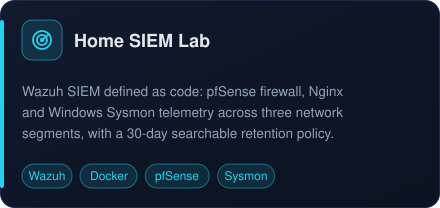</a>
  <a href="https://github.com/RoshFps/Shray8">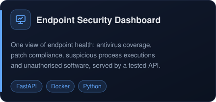</a>

  <a href="https://github.com/RoshFps/AES-Encrypt-Decrypt">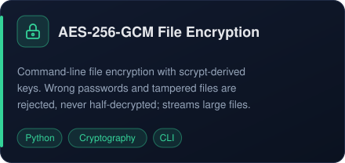</a>
  <a href="https://github.com/RoshFps/HTML-and-CSS-Code-Generation-using-Image-Recognition">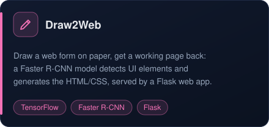</a>

  <a href="https://github.com/RoshFps/Object-Detection-in-Autonomous-Driving-System">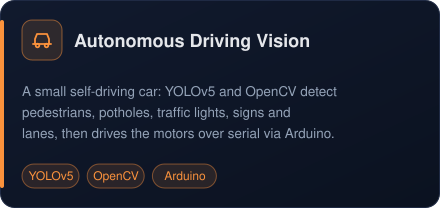</a>
  <a href="https://github.com/RoshFps/Bangalore-Explorer">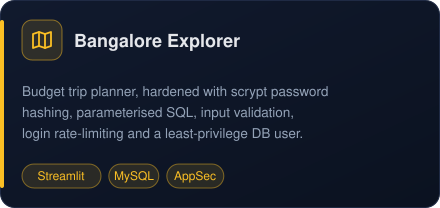</a>

<b>🔬 Research &amp; coursework projects</b>

 

| Project | What I built |
| --- | --- |
| **Coverage-guided vulnerability fuzzing pipeline** | A grey-box fuzzer combining mutation and grammar-based inputs, with branch-coverage feedback from instrumented binaries. It found crashes in 3 target programs. |
| **Grammar mining &amp; protocol input modelling** | AST-based pipelines that extract input grammars and generate thousands of grammar-conforming inputs to stress protocol parsers. |

  

  

<b>What I practise in security</b>

 

| Area | Focus |
| --- | --- |
| Web application attacks | XSS, SQLi, CSRF, SSRF, clickjacking, command injection |
| Binary analysis | Reverse engineering with Ghidra, crash triage |
| Testing | Coverage-guided fuzzing, grammar mining, grammar-based test generation |
| Cryptography | AES (CBC, GCM), key derivation (PBKDF2, scrypt), IV and nonce handling |
| Forensics &amp; networks | Autopsy, Wireshark traffic analysis, Wazuh and Sysmon telemetry, Android app security |
| Governance | Risk registers, Statements of Applicability, business impact analysis, tabletop exercises |

| | |
| --- | --- |
| 🎓 **M.Sc. Cybersecurity** | Saarland University, Saarbrücken · *Oct 2024 – present* Web Security · IT Forensics · ML in Cybersecurity · seminars on agentic networks and on the politics of security &amp; privacy |
| 🎓 **B.E. Computer Science &amp; Engineering** | The Oxford College of Engineering (VTU), Bengaluru · *2020 – 2024* |
| 💼 **Embedded Systems Development Intern** | Emterxe Technology Pvt. Ltd., Bengaluru · *Aug – Oct 2023* PIC16F877A firmware, timing-critical protocol debugging, test documentation in a 5-person agile team |

  <picture>
    <source media="(prefers-color-scheme: dark)" srcset="https://raw.githubusercontent.com/RoshFps/RoshFps/output/github-contribution-grid-snake-dark.svg">
    <source media="(prefers-color-scheme: light)" srcset="https://raw.githubusercontent.com/RoshFps/RoshFps/output/github-contribution-grid-snake.svg">
    
  </picture>

---

  💬 Happy to talk about web security, GRC or crypto implementations. <a href="mailto:roshan7156@gmail.com">Drop me a line</a>.

